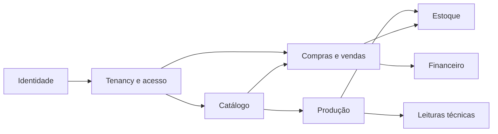
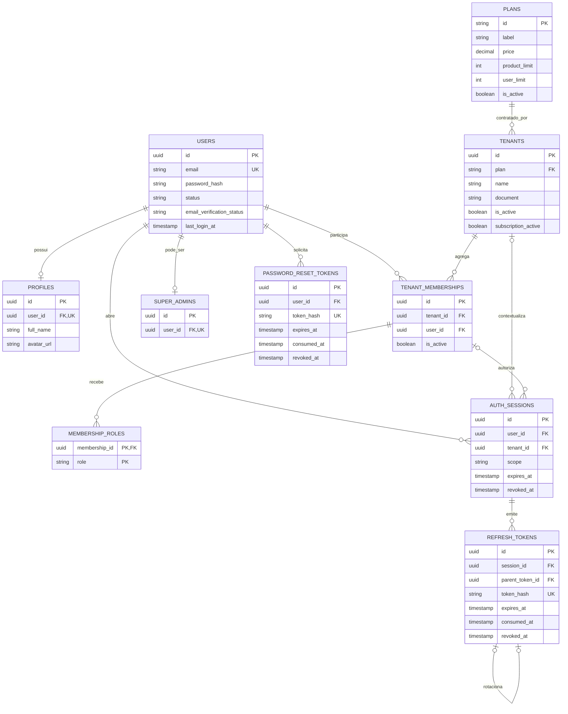
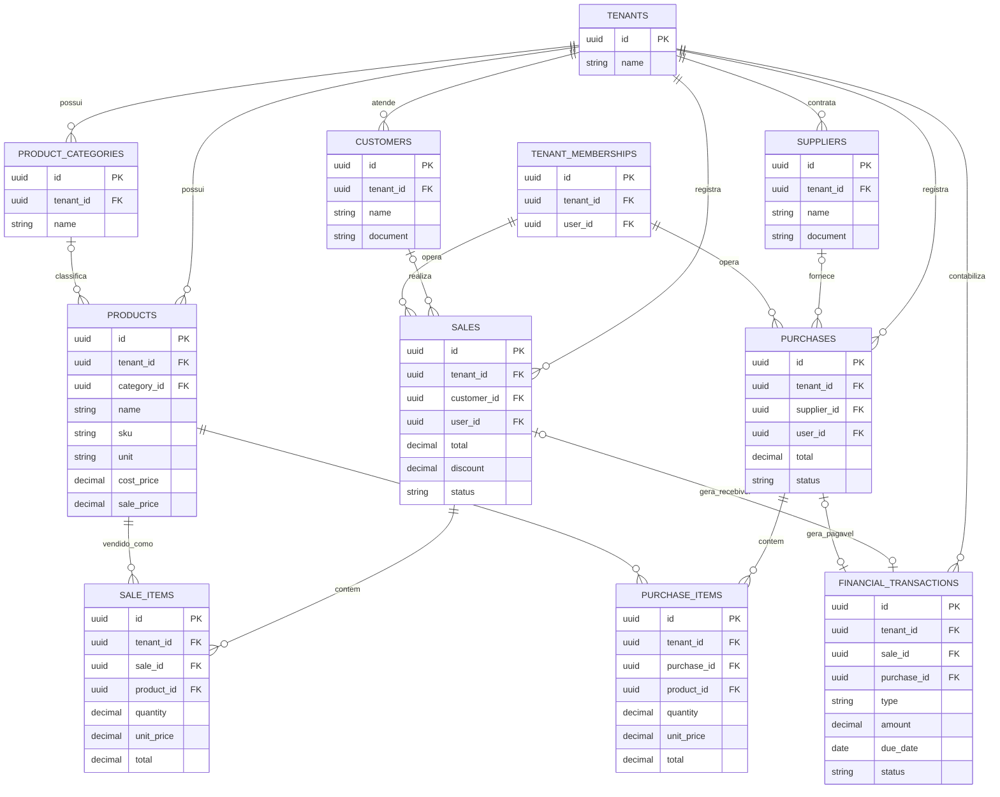
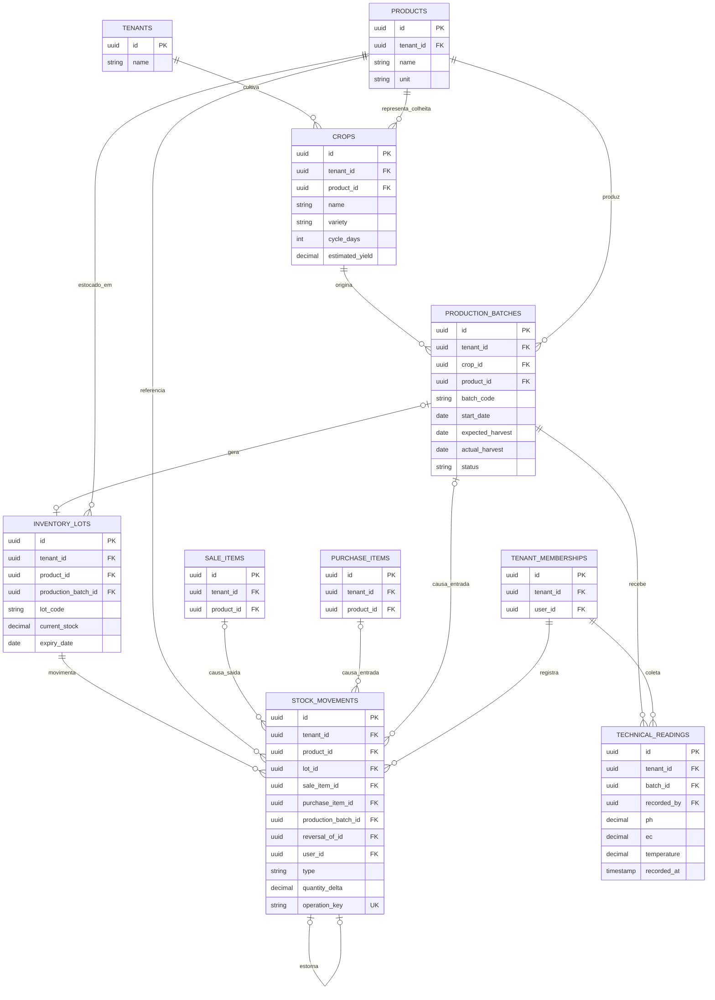

# Diagramas do modelo de dados

Estes diagramas apresentam visões simplificadas do modelo definido em
[`schema.db.sql`](./schema.db.sql). Campos auxiliares, índices e constraints foram omitidos para
manter a leitura clara. O arquivo SQL permanece como fonte de verdade, enquanto
[`schema.dbml`](./schema.dbml) contém a representação detalhada para o dbdiagram.io.

## Visão geral dos domínios

## Identidade, tenancy e autenticação

Uma sessão de tenant referencia simultaneamente o usuário, o tenant e o respectivo vínculo. Uma
sessão global não possui tenant. Os refresh tokens formam uma cadeia de rotação por sessão.

## Catálogo, compras, vendas e financeiro

Os itens preservam nome, unidade e preço como snapshots comerciais. Uma venda ou compra pode
gerar no máximo uma transação financeira no escopo atual.

## Produção, estoque e leituras técnicas

Cada movimento pertence ao mesmo tenant, produto e lote das entidades que lhe deram origem. O
saldo materializado do lote deve ser atualizado na mesma transação em que o movimento imutável é
gravado.
